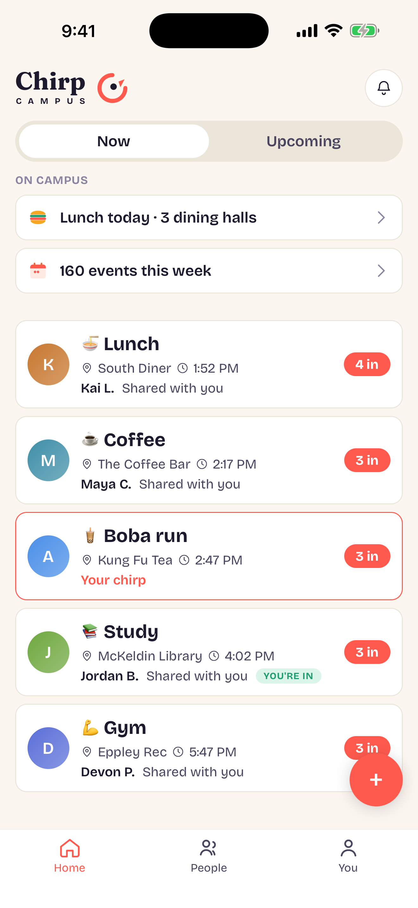
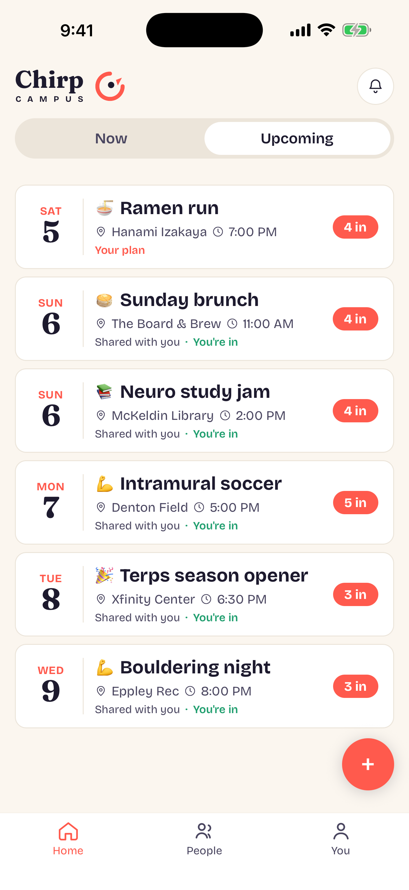
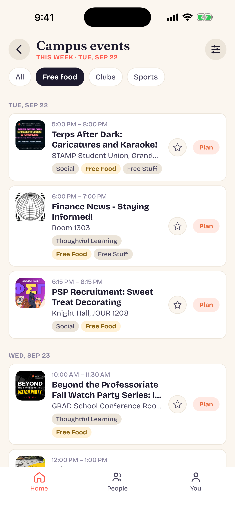

<h1 align="center">Hi 👋 My name is Arpan Agarwal</h1>

<h3 align="center">
  CS & Math @ University of Maryland · Co-Founder of Chirp Campus 
  Full-stack engineer who loves shipping things to real users.
</h3>

  
  

---

# 📱 Apps I've Shipped

## 🐦 Chirp Campus
### Say you're free, see who else is.
A friends-only app that makes it easy for UMD students to start plans, built from the ground up as co-founder.

  
  
  

**What it does:** live "chirps" for today's plans and RSVPs for upcoming ones, every TerpLink club event and Maryland game pulled in automatically, live UMD dining menus with allergen tags, groups with invite links and QR codes, and an opt-in way to meet new people. Privacy-first: no public feed, no location tracking, no photos.

- React Native (Expo) frontend with an Express.js + PostgreSQL backend, all in TypeScript
- CI/CD with GitHub Actions, deployed on Railway
- Async push notifications, race-condition-safe database logic, and automated content screening

## 🍽️ DiningIQ
### AI-powered meal planning for university dining halls.
Built for University of Maryland

  
  
  

- Web Scrapes 1,500–2,000 dining hall menu items and their nutrition data daily (Scrapy + Playwright)
- Generates personalized daily meal plans with via the OpenAI Batch API, cutting generation costs by 50%
- JWT-secured REST API with Google and Apple sign-in, deployed on Railway

---

# 🛠️ Tech I Work With

### Languages

### Frameworks & Libraries

### Tools & Platforms

### Also: Expo · Railway · Twilio · Pandas · NumPy

---

<h3 align="center"><i>Always shipping something. Check out my repos below 👇</i></h3>
